# Screensaver FX

[English](README.md) · **Español**

Protector de pantalla nativo para Windows (`.scr`), macOS (`.saver`) y Linux con Omarchy (en la terminal), con las animaciones del screensaver de Omarchy y 35 efectos nuevos. El núcleo está en Rust (`core/`, sin dependencias de plataforma) y cada sistema tiene un envoltorio fino: los 41 efectos y la letra del rótulo son los mismos en los tres. No usa ningún motor web y ocupa unos 5 MB de RAM. En Windows deja de dibujar mientras la pantalla está apagada.

## Efectos

<p align="center">
  
  
  
  
</p>

<details>
<summary>Los 41 efectos</summary>

| | | |
|:-:|:-:|:-:|
| <br>Neón | 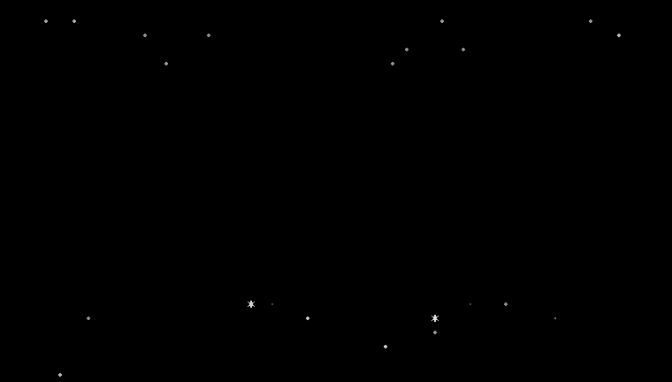<br>Estrellas | 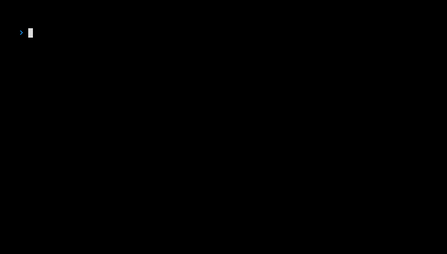<br>Terminal |
| 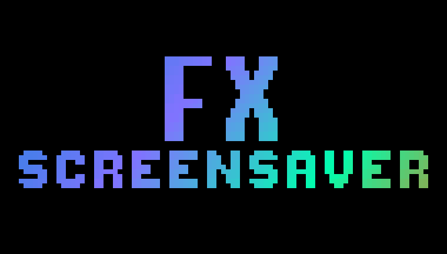<br>Glitch | <br>Plasma | <br>Reloj |
| <br>Descifrado | <br>Lluvia | <br>Rayos |
| <br>Deslizar | <br>Dispersión | 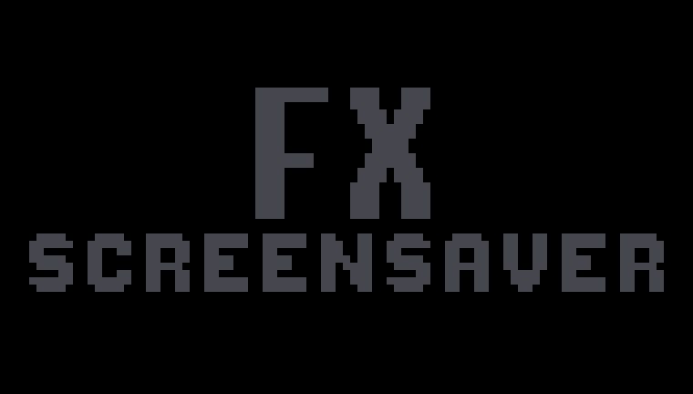<br>Fuego |
| 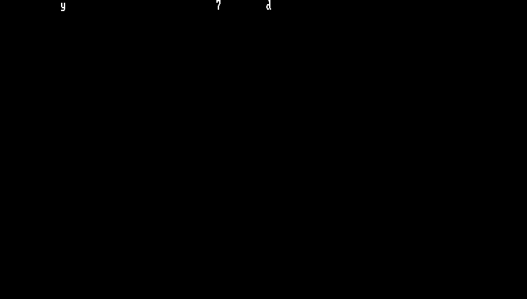<br>Matrix | 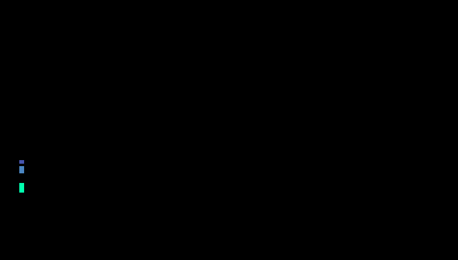<br>Olas | <br>Focos |
| <br>Barrido | <br>Relevo | <br>Cometa |
| <br>Marea | <br>Remolino | 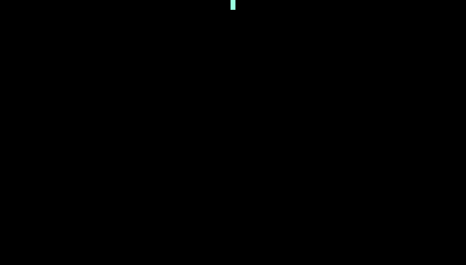<br>Gota |
| 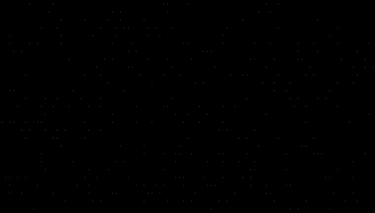<br>Luciérnagas | <br>Aurora | <br>Láser |
| <br>Ecualizador | <br>Mosaico | <br>Tormenta |
| <br>Persiana | <br>Espiral | <br>Fuegos artificiales |
| <br>Rebote | <br>Cristal | <br>Retro |
| <br>Burbujas | <br>Radar | 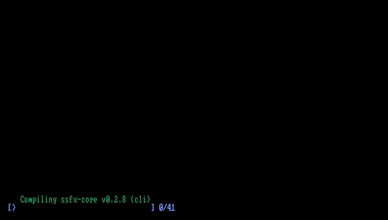<br>Compilación |
| 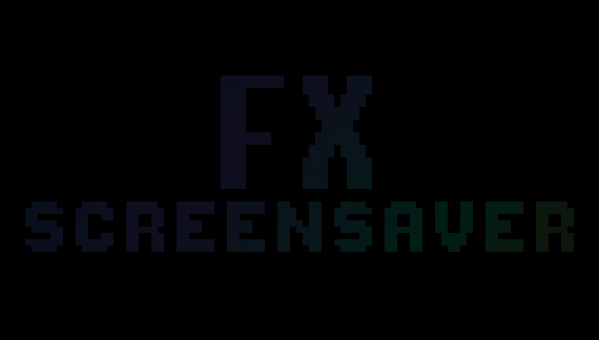<br>Circuito | <br>Volcado hex | 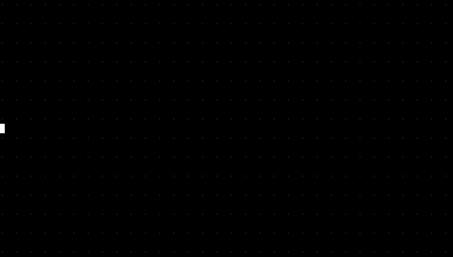<br>Latido |
| <br>ADN | 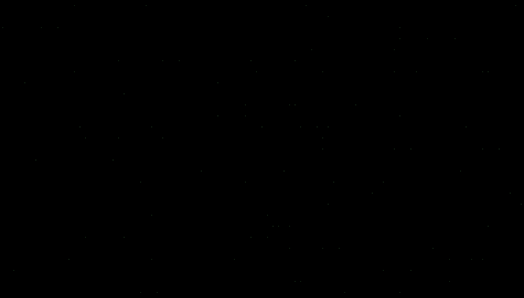<br>Tinta | |

</details>

## Instalar

### Windows 10/11

- **Instalador:** descarga `ScreensaverFX-Setup.exe` de [Releases](https://github.com/thealejandro/screensaver-fx/releases/latest). Permite personalizar el rótulo, los colores y los efectos con una vista previa en vivo.
- **winget** (en revisión en el catálogo de Microsoft; funcionará cuando lo aprueben): `winget install thealejandro.ScreensaverFX`
- **Scoop:** `scoop bucket add thealejandro https://github.com/thealejandro/scoop-bucket` y luego `scoop install thealejandro/screensaver-fx`
- **Terminal** (sin permisos de administrador):

  ```powershell
  irm https://raw.githubusercontent.com/thealejandro/screensaver-fx/main/install.ps1 | iex
  ```

  Para desinstalar: `& ([scriptblock]::Create((irm https://raw.githubusercontent.com/thealejandro/screensaver-fx/main/install.ps1))) -Uninstall`

«Para todos los usuarios» (pide administrador) lo deja en `System32`, en la lista de protectores de Windows para cualquier cuenta; «Solo para mí» no pide permisos.

Algunas apps en primer plano bloquean el protector de Windows aunque no estén reproduciendo nada. Por eso se instala un vigilante mínimo (`ScreensaverFX.exe /watch`, ~1,3 MB, arranca con la sesión): si pasa el tiempo de espera y Windows no lanzó el protector configurado, lo lanza él. Respeta lo mismo que Windows: vídeo o videollamadas, presentaciones, pantalla completa, sesión bloqueada y «Mostrar la pantalla de inicio de sesión al reanudar».

Lo que hace queda en `%APPDATA%\ScreensaverFX\watch.log` (por qué lo lanzó o por qué no).

### Actualizaciones automáticas

Screensaver FX se actualiza solo desde las [releases](https://github.com/thealejandro/screensaver-fx/releases), sin tocar tu configuración ni el protector que tengas elegido:

- **Para todos los usuarios**: la tarea programada `ScreensaverFX\Update` (como SYSTEM) busca al arrancar el equipo y una vez al día. Registro en `%ProgramData%\ScreensaverFX\update.log`.
- **Solo para mí**: el vigilante busca a los 3 minutos de iniciar sesión y luego cada 24 h. Registro en `watch.log`.

Nunca instala con el protector o la configuración abiertos. El instalador se descarga por HTTPS y se comprueba con la suma SHA-256 publicada en la release antes de ejecutarlo. Para buscar a mano: `ScreensaverFX.exe /update`.

El instalador no está firmado, así que SmartScreen puede avisar: «Más información» › «Ejecutar de todas formas».

### macOS 11 o posterior

- **Arrastrar:** abre `ScreensaverFX.dmg` de [Releases](https://github.com/thealejandro/screensaver-fx/releases/latest) y arrastra el protector sobre «Screen Savers» (Finder pide tu contraseña porque se instala para todos los usuarios).
- **Instalador:** `ScreensaverFX.pkg`, de la misma página.
- **Homebrew:** `brew install --cask thealejandro/tap/screensaver-fx` (sin aviso de Gatekeeper; `brew upgrade` lo actualiza).
- **Terminal:**

  ```bash
  curl -fsSL https://raw.githubusercontent.com/thealejandro/screensaver-fx/main/install.sh | bash
  ```

Ni el .pkg ni el .dmg están notarizados. Si macOS bloquea el instalador o el protector, ve a Ajustes del Sistema › Privacidad y seguridad › «Abrir igualmente». Con el método de la terminal no aparece el aviso.

### Linux (Omarchy)

Requisitos: Omarchy con `ttfx` y, para compilar, [rustup](https://rustup.rs). Sin Rust, el instalador descarga el binario de la última release.

```bash
git clone https://github.com/thealejandro/screensaver-fx && cd screensaver-fx
./linux/install.sh
```

Para actualizar, `git pull` y volver a ejecutar `./linux/install.sh`. Para quitarlo, `./linux/uninstall.sh`.

No modifica nada de Omarchy: copia el binario `screensaver-fx` y dos envoltorios (`ttfx` y `omarchy-screensaver`) a `~/.local/bin`, que va antes que `/usr/bin` en el PATH. El salvapantallas de Omarchy sigue llamando a `ttfx`; el envoltorio decide en cada ciclo entre una animación de Screensaver FX y un efecto de ttfx (con sus colores o con los del tema). Si una actualización de Omarchy cambia cómo lanza el protector, el envoltorio deja pasar la llamada tal cual y el protector vuelve a ser el original, sin romperse. Tras cada `omarchy update` un hook comprueba que todo sigue encajando y avisa con una notificación si hay algo que adaptar (detalle en `~/.local/state/omarchy/screensaver-check.log`).

Sin configuración usa lo que ya tiene Omarchy: el rótulo de `~/.config/omarchy/branding/screensaver.txt` y los colores del tema activo. Para cambiarlo, `~/.config/screensaver-fx/config.ini` admite las mismas claves que en Windows (`banner`, `title`, `subtitle`, `font`, `theme`, `effects`, `lang`) y una propia:

| Clave | Qué hace |
| --- | --- |
| `own=35` | Porcentaje de ciclos con animación de Screensaver FX; el resto son efectos de ttfx |

Para que los efectos de ttfx muestren el mismo rótulo de texto:

```bash
screensaver-fx --write-banner "Título" "subtítulo" --font shadow
```

Guarda el rótulo en `screensaver.txt` (el anterior queda en `screensaver.txt.bak`) y, si una actualización de Omarchy lo pisa con su logo, el hook lo vuelve a generar.

El binario también funciona suelto en cualquier terminal con color de 24 bits, en Linux o macOS: `screensaver-fx --loop` (Ctrl+C para salir), `screensaver-fx plasma`, `screensaver-fx --list`.

## Varios monitores

Todos los monitores van sincronizados: el mismo efecto y el mismo tema a la vez en cada pantalla. Tres efectos usan el escritorio entero y pasan de un monitor al siguiente, de izquierda a derecha, con cualquier número de pantallas y aunque tengan tamaños, escalas u orientaciones distintas:

- **Relevo:** las letras del rótulo saltan en arco de una pantalla a la siguiente y al final se encienden en todas.
- **Cometa:** un cometa cruza el escritorio, ilumina el rótulo de cada pantalla al pasar y deja una estela de chispas.
- **Marea:** una ola de color recorre todos los monitores, va encendiendo los rótulos y vuelve.

Con un solo monitor también funcionan, dentro de esa pantalla.

El orden de las pantallas es el de **Configuración › Pantalla** en Windows (o **Ajustes del Sistema › Pantallas** en macOS), según cómo estén colocadas, no el número que les da el sistema. En el configurador de Windows, **Identificar pantallas** muestra en cada una su número en ese orden y cuál es la principal. En **Varias pantallas** se elige cómo se reparten (`screens=` en `config.ini`):

| Opción | `screens=` | Qué hace |
|---|---|---|
| Un escritorio: los efectos cruzan | `span` (por defecto) | Lo de arriba: todas sincronizadas y los efectos de escritorio pasan de una a otra. |
| Cada pantalla por su cuenta | `each` | Cada pantalla con su propio orden de efectos y colores, sin cruzar. |
| Solo la principal | `main` | Anima solo la pantalla principal; las demás quedan en negro. |

## Compilar

### macOS

Requisitos: [rustup](https://rustup.rs) y las Command Line Tools (`xcode-select --install`).

```bash
./macos/build.sh --install     # compila e instala en ~/Library/Screen Savers
./macos/package.sh             # dist/ScreensaverFX-macOS.zip, ScreensaverFX-<versión>.pkg y .dmg
```

### Windows

Requisitos: rustup con el toolchain `stable-x86_64-pc-windows-gnullvm`, [llvm-mingw](https://github.com/mstorsjo/llvm-mingw) en el PATH e [Inno Setup 6.7+](https://jrsoftware.org/isinfo.php) para el instalador.

```bash
cargo build -p screensaver-fx --release
cargo build -p screensaver-fx --release --target aarch64-pc-windows-gnullvm
ISCC installer\windows\ScreensaverFX.iss          # dist\ScreensaverFX-Setup-<versión>.exe
```

Argumentos del `.scr`: `/s` pantalla completa, `/p <hwnd>` vista previa, `/c` configuración, `/w` ventana de prueba. La configuración vive en `%APPDATA%\ScreensaverFX\config.ini`.

### Linux

```bash
cargo build -p ssfx-term --release     # target/release/screensaver-fx
```

### Publicar una versión

```bash
git tag v0.1.0 && git push --tags
```

GitHub Actions compila Windows (x64 + ARM64), macOS (universal) y Linux (x86_64 + aarch64, estático) y sube los instaladores a Releases, con una tabla de qué descargar según el equipo y los cambios `feat`/`fix`/`perf` desde la versión anterior (`.github/release-notes.sh`).

## Rótulo y letra

El rótulo puede ser el de por defecto, un texto propio (`banner=text` con `title` y `subtitle`) o un arte ASCII propio. El texto se dibuja con letras de bloque hechas a mano (A-Z, 0-9, signos, tildes y Ñ). La clave `font` de `config.ini` elige el estilo:

| `font=` | Estilo |
| --- | --- |
| `block` | Letras de bloque macizas (por defecto) |
| `shadow` | Bloque con sombra `░` |
| `outline` | Solo el contorno del título |
| `pixel` | Letra de píxel 8x8 de las versiones anteriores (conserva las minúsculas) |

De momento `font` no tiene control en las ventanas de configuración: se escribe a mano en `%APPDATA%\ScreensaverFX\config.ini` (Windows), en `~/.config/screensaver-fx/config.ini` (Linux) o con `defaults -currentHost write` sobre la clave `font` del módulo (macOS). Guardar desde la ventana conserva el valor.

## Herramientas

```bash
cargo run -p ssfx-core --example snap --release -- snaps auto 1920 1080 "banner=text|title=Hola"   # fotogramas a PNG
cargo run -p ssfx-core --example snap --release -- snaps auto 1920 1080 "" 0.1,0.3,0.6 vortex,laser   # solo esos momentos y efectos
cargo run -p ssfx-core --example banner -- "Título" "subtítulo" shadow                             # el rótulo, en la terminal
cargo run -p ssfx-core --example brand --release -- installer/assets                              # icono e imágenes
cargo run -p ssfx-core --example desk --release -- desk relay,comet,tide 8                          # escritorio de 3 monitores a PNG
cargo run -p ssfx-core --example gif --release -- fx                                                # GIFs de la galería (rama media)
```
