# Screensaver FX

**English** · [Español](README.es.md) · **[Live demo](https://thealejandro.github.io/screensaver-fx/)**

A native, lightweight screensaver for Windows (`.scr`), macOS (`.saver`) and Linux with Omarchy (in the terminal), with the animations of the Omarchy screensaver plus 35 new effects. The core is written in Rust (`core/`, no platform dependencies) and each OS gets a thin wrapper, so all 41 effects and the banner font are identical everywhere. No web engine, about 5 MB of RAM, and on Windows it stops drawing while the display is off.

## Effects

<p align="center">
  
  
  
  
</p>

<details>
<summary>All 41 effects</summary>

| | | |
|:-:|:-:|:-:|
| <br>Neon | 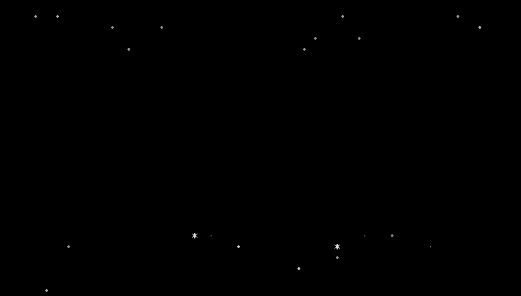<br>Starfield | 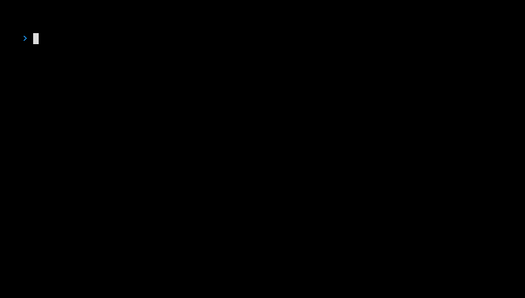<br>Terminal |
| 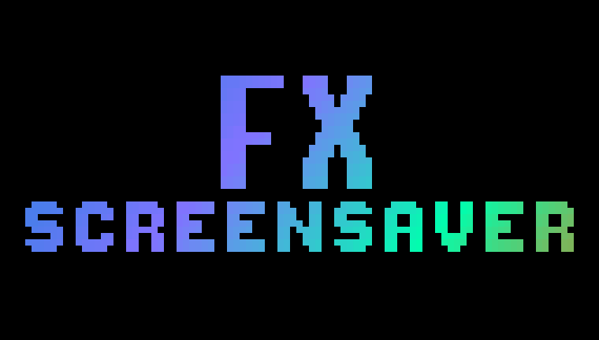<br>Glitch | <br>Plasma | <br>Clock |
| <br>Decrypt | <br>Rain | <br>Beams |
| <br>Slide | <br>Scatter | 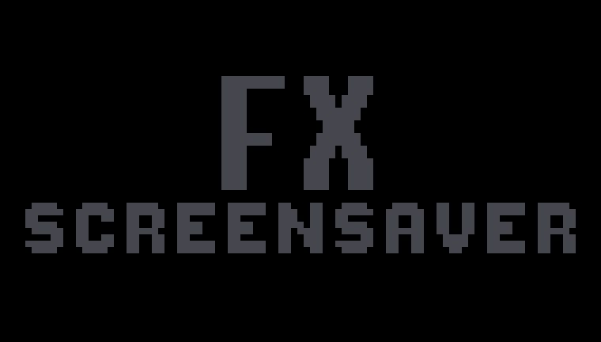<br>Burn |
| 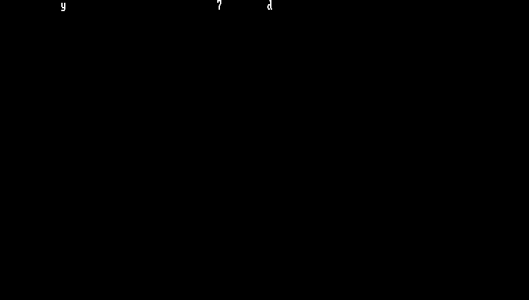<br>Matrix | 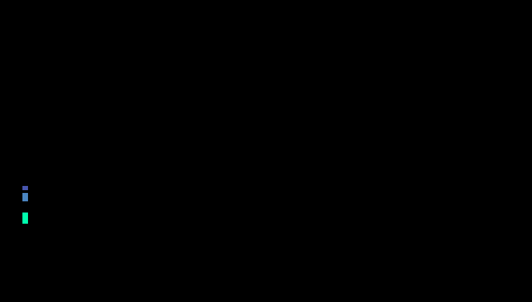<br>Waves | <br>Spotlights |
| <br>Wipe | <br>Relay | <br>Comet |
| <br>Tide | <br>Vortex | 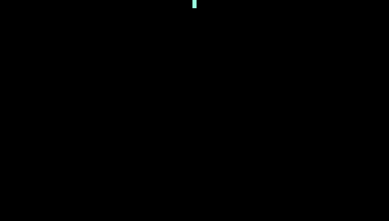<br>Ripple |
| 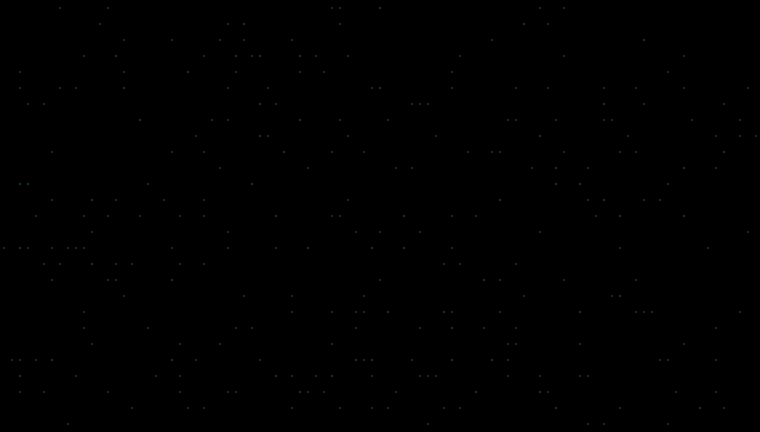<br>Fireflies | <br>Aurora | <br>Laser |
| <br>Equalizer | <br>Mosaic | <br>Storm |
| <br>Blinds | <br>Spiral | <br>Fireworks |
| <br>Bounce | <br>Crystal | <br>Retro |
| <br>Bubbles | <br>Radar | 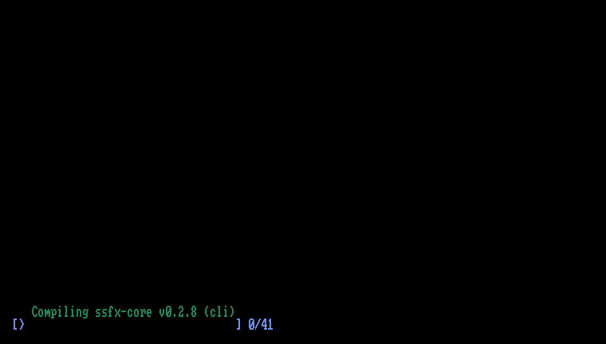<br>Compile |
| 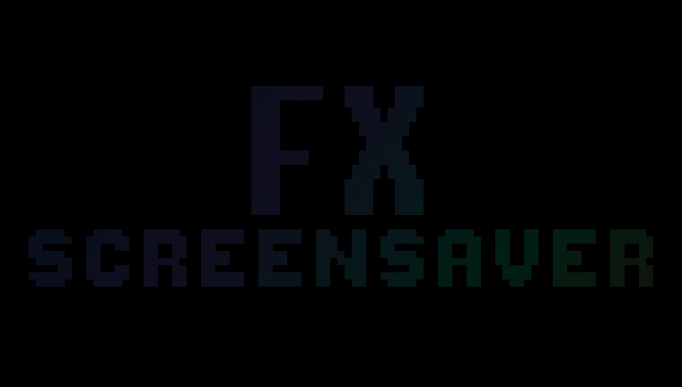<br>Circuit | <br>Hex dump | 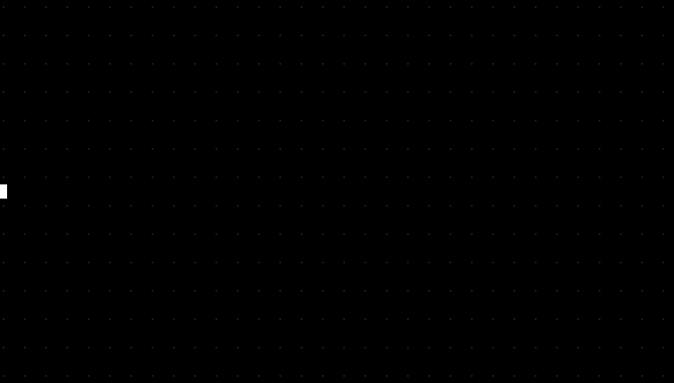<br>Heartbeat |
| <br>DNA | 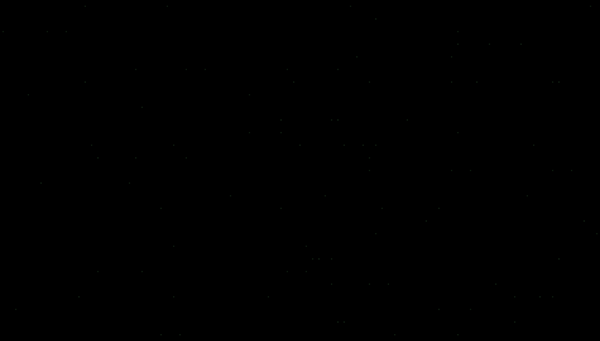<br>Ink |  |

</details>

## Install

### Windows 10/11

- **Installer:** download `ScreensaverFX-Setup.exe` from [Releases](https://github.com/thealejandro/screensaver-fx/releases/latest). It lets you customize the banner, colors and effects with a live preview.
- **winget** (pending review in Microsoft's catalog; it will work once approved): `winget install thealejandro.ScreensaverFX`
- **Scoop:** `scoop bucket add thealejandro https://github.com/thealejandro/scoop-bucket` and then `scoop install thealejandro/screensaver-fx`
- **Terminal** (no admin rights):

  ```powershell
  irm https://raw.githubusercontent.com/thealejandro/screensaver-fx/main/install.ps1 | iex
  ```

  To uninstall: `& ([scriptblock]::Create((irm https://raw.githubusercontent.com/thealejandro/screensaver-fx/main/install.ps1))) -Uninstall`

"For all users" (asks for admin) installs to `System32`, so it shows up in the Windows screensaver list for every account; "Just for me" needs no permissions.

Some foreground apps block the Windows screensaver even when they aren't playing anything. That's why a tiny watcher is installed (`ScreensaverFX.exe /watch`, ~1.3 MB, starts with your session): if the idle timeout passes and Windows didn't launch the configured screensaver, the watcher does. It respects the same things Windows does: video or calls, presentations, full screen, a locked session and "On resume, display logon screen". Its decisions are logged to `%APPDATA%\ScreensaverFX\watch.log`.

### Automatic updates

Screensaver FX updates itself from [Releases](https://github.com/thealejandro/screensaver-fx/releases) without touching your settings or your chosen screensaver:

- **For all users:** the scheduled task `ScreensaverFX\Update` (as SYSTEM) checks at boot and once a day. Log in `%ProgramData%\ScreensaverFX\update.log`.
- **Just for me:** the watcher checks 3 minutes after sign-in and then every 24 h. Log in `watch.log`.

It never installs while the screensaver or the settings are open. The installer is downloaded over HTTPS and verified against the SHA-256 published in the release before it runs. To check manually: `ScreensaverFX.exe /update`.

The installer isn't signed, so SmartScreen may warn you: "More info" › "Run anyway".

### macOS 11 or later

- **Drag and drop:** open `ScreensaverFX.dmg` from [Releases](https://github.com/thealejandro/screensaver-fx/releases/latest) and drag the screensaver onto "Screen Savers" (Finder asks for your password because it installs for all users).
- **Installer:** `ScreensaverFX.pkg`, from the same page.
- **Homebrew:** `brew install --cask thealejandro/tap/screensaver-fx` (no Gatekeeper prompt; `brew upgrade` keeps it updated).
- **Terminal:**

  ```bash
  curl -fsSL https://raw.githubusercontent.com/thealejandro/screensaver-fx/main/install.sh | bash
  ```

Neither the .pkg nor the .dmg is notarized. If macOS blocks the installer or the screensaver, go to System Settings › Privacy & Security › "Open Anyway". The terminal method doesn't trigger the prompt.

### Linux (Omarchy)

Requirements: Omarchy with `ttfx` and, to build, [rustup](https://rustup.rs). Without Rust, the installer downloads the binary from the latest release.

```bash
git clone https://github.com/thealejandro/screensaver-fx && cd screensaver-fx
./linux/install.sh
```

To update, `git pull` and run `./linux/install.sh` again. To remove it, `./linux/uninstall.sh`.

It doesn't modify Omarchy: it copies the `screensaver-fx` binary and two wrappers (`ttfx` and `omarchy-screensaver`) to `~/.local/bin`, which comes before `/usr/bin` in the PATH. Omarchy's screensaver keeps calling `ttfx`; on each cycle the wrapper picks either a Screensaver FX animation or a ttfx effect. If an Omarchy update changes how the screensaver is launched, the wrapper passes the call through untouched and you get the original screensaver back, so nothing breaks. After every `omarchy update` a hook checks that everything still fits and sends a notification if something needs adapting (details in `~/.local/state/omarchy/screensaver-check.log`).

With no configuration it uses what Omarchy already has: the banner from `~/.config/omarchy/branding/screensaver.txt` and the active theme's colors. To change it, `~/.config/screensaver-fx/config.ini` takes the same keys as on Windows (`banner`, `title`, `subtitle`, `font`, `theme`, `effects`, `lang`) plus one of its own:

| Key | What it does |
| --- | --- |
| `own=35` | Percentage of cycles that run a Screensaver FX animation; the rest are ttfx effects |

To make the ttfx effects show the same text banner:

```bash
screensaver-fx --write-banner "Title" "subtitle" --font shadow
```

It saves the banner to `screensaver.txt` (the previous one goes to `screensaver.txt.bak`) and, if an Omarchy update overwrites it with its logo, the hook regenerates it.

The binary also runs standalone in any 24-bit color terminal on Linux or macOS: `screensaver-fx --loop` (Ctrl+C to quit), `screensaver-fx plasma`, `screensaver-fx --list`.

## Multiple monitors

All monitors stay in sync: the same effect and theme at the same time on every screen. Three effects use the whole desktop and travel from one monitor to the next, left to right, with any number of screens, even with different sizes, scaling or orientation:

- **Relay:** the banner's letters jump in an arc from one screen to the next and finally light up on all of them.
- **Comet:** a comet crosses the desktop, lights up each screen's banner as it passes and leaves a trail of sparks.
- **Tide:** a wave of color sweeps across all monitors, lighting up the banners, and comes back.

With a single monitor they also work, within that screen.

Screen order follows **Settings › Display** on Windows (or **System Settings › Displays** on macOS), by how they're arranged, not by the number the system assigns. In the Windows settings dialog, **Identify displays** shows each screen's number in that order and which one is the main one. **Multiple displays** chooses how they're used (`screens=` in `config.ini`):

| Option | `screens=` | What it does |
|---|---|---|
| One desktop: effects cross over | `span` (default) | As above: all in sync and desktop effects travel between screens. |
| Each screen on its own | `each` | Each screen with its own order of effects and colors, no crossing. |
| Main screen only | `main` | Animates only the main screen; the others stay black. |

## Banner and font

The banner can be the default one, your own text (`banner=text` with `title` and `subtitle`) or your own ASCII art. Text is drawn with hand-made block letters (A-Z, 0-9, punctuation, accents and Ñ). The `font` key in `config.ini` picks the style:

| `font=` | Style |
| --- | --- |
| `block` | Solid block letters (default) |
| `shadow` | Block with a `░` shadow |
| `outline` | Title outline only |
| `pixel` | 8x8 pixel font from earlier versions (keeps lowercase) |

For now `font` has no control in the settings dialogs: set it by hand in `%APPDATA%\ScreensaverFX\config.ini` (Windows), in `~/.config/screensaver-fx/config.ini` (Linux) or with `defaults -currentHost write` on the module's `font` key (macOS). Saving from the dialog keeps the value.

## Building

### macOS

Requirements: [rustup](https://rustup.rs) and the Command Line Tools (`xcode-select --install`).

```bash
./macos/build.sh --install     # builds and installs to ~/Library/Screen Savers
./macos/package.sh             # dist/ScreensaverFX-macOS.zip, ScreensaverFX-<version>.pkg and .dmg
```

### Windows

Requirements: rustup with the `stable-x86_64-pc-windows-gnullvm` toolchain, [llvm-mingw](https://github.com/mstorsjo/llvm-mingw) in the PATH and [Inno Setup 6.7+](https://jrsoftware.org/isinfo.php) for the installer.

```bash
cargo build -p screensaver-fx --release
cargo build -p screensaver-fx --release --target aarch64-pc-windows-gnullvm
ISCC installer\windows\ScreensaverFX.iss          # dist\ScreensaverFX-Setup-<version>.exe
```

`.scr` arguments: `/s` full screen, `/p <hwnd>` preview, `/c` settings, `/w` test window. Settings live in `%APPDATA%\ScreensaverFX\config.ini`.

### Linux

```bash
cargo build -p ssfx-term --release     # target/release/screensaver-fx
```

### Releasing

```bash
git tag v0.1.0 && git push --tags
```

GitHub Actions builds Windows (x64 + ARM64), macOS (universal) and Linux (x86_64 + aarch64, static), uploads the installers to Releases with a what-to-download table and the `feat`/`fix`/`perf` changes since the previous version (`.github/release-notes.sh`), and updates Homebrew.

## Tools

```bash
cargo run -p ssfx-core --example snap --release -- snaps auto 1920 1080 "banner=text|title=Hello"   # frames to PNG
cargo run -p ssfx-core --example snap --release -- snaps auto 1920 1080 "" 0.1,0.3,0.6 vortex,laser  # only those moments and effects
cargo run -p ssfx-core --example banner -- "Title" "subtitle" shadow                                # the banner, in the terminal
cargo run -p ssfx-core --example brand --release -- installer/assets                                # icon and images
cargo run -p ssfx-core --example desk --release -- desk relay,comet,tide 8                           # 3-monitor desktop to PNG
cargo run -p ssfx-core --example gif --release -- fx                                                 # gallery GIFs (media branch)
```

## License

[MIT](LICENSE)
